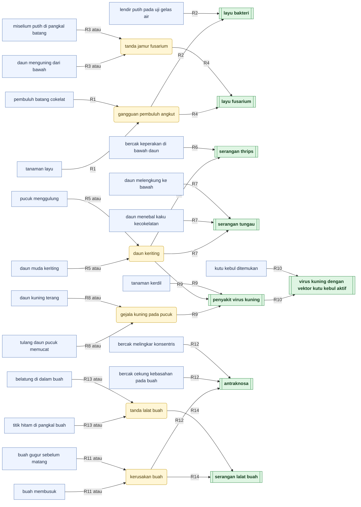
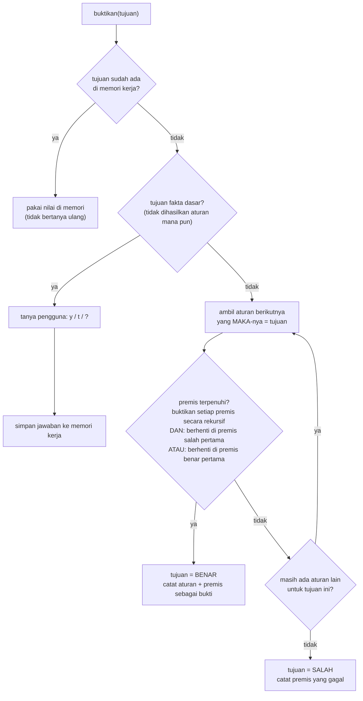
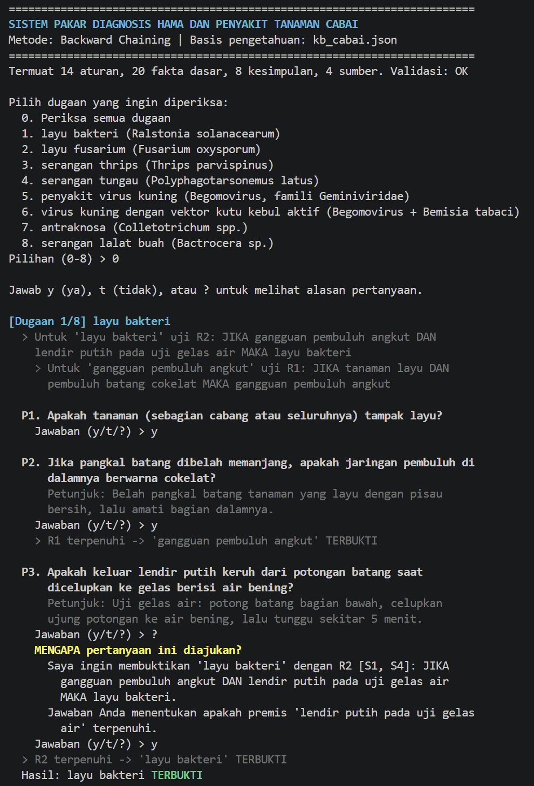
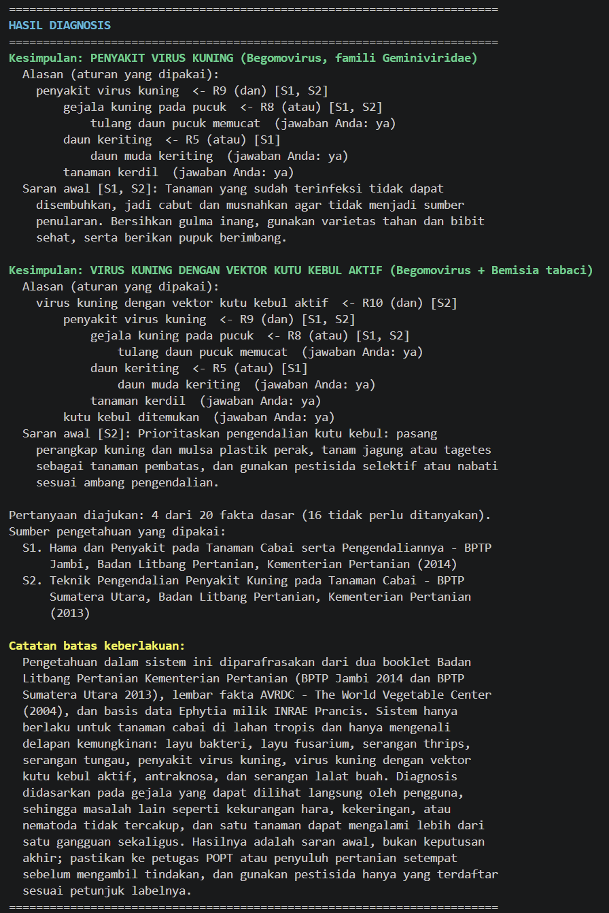
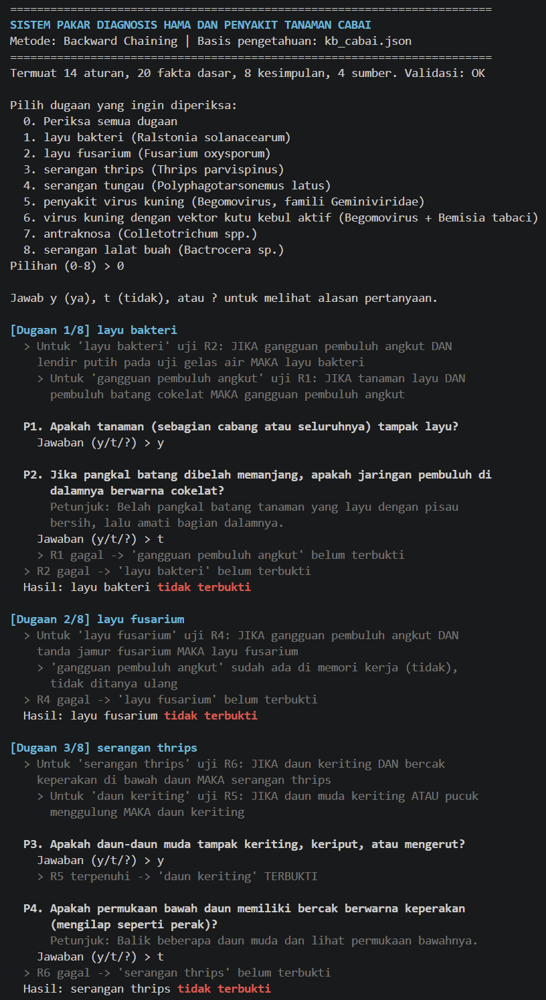
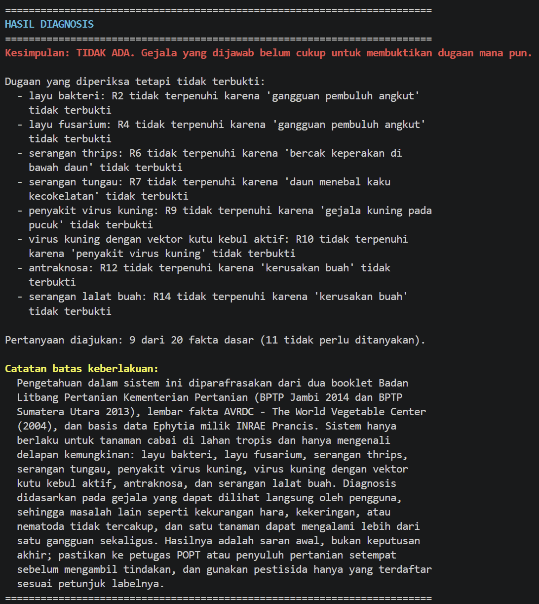

# TUGAS SISTEM PAKAR (EXPERT SYSTEM) KECERDASAN BUATAN

### Sistem Pakar Diagnosis Hama dan Penyakit Tanaman Cabai dengan Backward Chaining


Program konsultasi berbasis teks yang membantu mengenali penyebab gangguan pada tanaman cabai dari gejala yang terlihat. Pengetahuan diambil dari publikasi Kementerian Pertanian, AVRDC - The World Vegetable Center, dan INRAE, lalu disusun menjadi 14 aturan IF-THEN di file JSON. Mesin inferensinya adalah **Backward Chaining** yang ditulis sendiri: program memulai dari dugaan, lalu hanya menanyakan gejala yang benar-benar diperlukan untuk membuktikan dugaan itu.

---

## Daftar Isi

1. [Identitas](#1-identitas)
2. [Topik dan Cara Menjalankan Program](#2-topik-dan-cara-menjalankan-program)
3. [Sumber dan Tabel Aturan](#3-sumber-dan-tabel-aturan)
4. [Metode yang Dipilih dan Alasannya](#4-metode-yang-dipilih-dan-alasannya)
5. [Tiga Kasus Uji dan Screenshot](#5-tiga-kasus-uji-dan-screenshot)
6. [Batas Keberlakuan](#6-batas-keberlakuan)
7. [Penggunaan Alat Bantu AI](#7-penggunaan-alat-bantu-ai)

---

## 1. Identitas

| | |
|---|---|
| **Nama** | Jauda Avaro Zufaru |
| **NIM** | F1D02410059 |
| **Kelas** | C |
| **Mata kuliah** | Kecerdasan Buatan (MKL1303131) |
| **Program studi** | Teknik Informatika, Universitas Mataram |
| **Tugas** | Tugas 5: Membuat Sistem Pakar Sederhana |

---

## 2. Topik dan Cara Menjalankan Program

### 2.1 Topik

**Diagnosis hama dan penyakit tanaman cabai.** Topik ini dipilih karena beberapa gangguan pada cabai memiliki gejala yang mirip sehingga mudah tertukar. Contohnya, layu bakteri dan layu fusarium sama-sama membuat tanaman layu dan pembuluh batang berwarna cokelat, padahal penanganannya berbeda. Contoh lainnya, daun keriting bisa disebabkan thrips, tungau, atau virus kuning. Membedakan kasus seperti ini adalah pekerjaan khas seorang pakar (petugas POPT atau penyuluh), sehingga cocok dijadikan sistem pakar. Topik ini juga dekat dengan lingkungan penulis di Lombok, tempat cabai banyak dibudidayakan, dan termasuk dalam contoh topik yang disarankan pada soal (hama dan penyakit cabai).

Sistem mengenali **8 kesimpulan**: layu bakteri, layu fusarium, serangan thrips, serangan tungau, penyakit virus kuning, virus kuning dengan vektor kutu kebul aktif, antraknosa, dan serangan lalat buah. Setiap kesimpulan disertai alasan (rantai aturan yang dipakai), sumber, dan saran pengendalian awal.

### 2.2 Kebutuhan

| Komponen | Keterangan |
|---|---|
| Bahasa | Python |
| Versi | Python 3.8 atau lebih baru (dikembangkan dan diuji pada Python 3.13) |
| Library | Tidak ada, hanya modul bawaan (`json`, `argparse`, `textwrap`, `os`, `sys`, `unittest`) |
| Sistem operasi | Windows, Linux, atau macOS |

### 2.3 Struktur Folder

```text
ai-tugas5-F1D02410059/
├── kb_cabai.json          # basis pengetahuan: sumber, aturan, pertanyaan, saran, batas
├── sistem_pakar.py        # mesin backward chaining + antarmuka konsultasi
├── test_sistem_pakar.py   # pengujian otomatis (unittest)
├── README.md
└── screenshot/            # bukti hasil uji
```

### 2.4 Menjalankan Program

Unduh atau clone repository ini, buka terminal di folder repository, lalu jalankan:

```bash
python sistem_pakar.py
```

Pada Windows, jika perintah `python` tidak dikenali, gunakan `py sistem_pakar.py`.

Langkah konsultasi:

1. Pilih dugaan yang ingin diperiksa. Angka `0` memeriksa semua dugaan; angka `1` sampai `8` memeriksa satu dugaan tertentu.
2. Jawab setiap pertanyaan dengan `y` (ya) atau `t` (tidak).
3. Ketik `?` untuk menampilkan **alasan pertanyaan itu diajukan** (fasilitas MENGAPA).
4. Di akhir konsultasi, program menampilkan kesimpulan, pohon alasan, saran awal, dugaan yang gagal beserta penyebabnya, jumlah pertanyaan yang diajukan, sumber, dan catatan batas keberlakuan.

Opsi tambahan:

| Perintah | Fungsi |
|---|---|
| `python sistem_pakar.py --tanpa-jejak` | Menyembunyikan jejak penalaran (hanya pertanyaan dan hasil) |
| `python sistem_pakar.py --tanpa-warna` | Mematikan warna teks di terminal |
| `python sistem_pakar.py --kb file.json` | Memakai file basis pengetahuan lain |
| `python -m unittest -v` | Menjalankan 11 pengujian otomatis |

---

## 3. Sumber dan Tabel Aturan

### 3.1 Daftar Sumber

Semua sumber berasal dari lembaga pemerintah atau lembaga riset resmi, bukan media sosial maupun forum.

| Kode | Judul | Penulis, Penerbit, Tahun | URL | Diakses |
|---|---|---|---|---|
| S1 | Hama dan Penyakit pada Tanaman Cabai serta Pengendaliannya | Araz Meilin; BPTP Jambi, Badan Litbang Pertanian, Kementerian Pertanian; 2014 | [repository.pertanian.go.id](https://repository.pertanian.go.id/bitstream/handle/123456789/10254/14bookcabe.pdf) | 14 November 2026 |
| S2 | Teknik Pengendalian Penyakit Kuning pada Tanaman Cabai | Lukas Sebayang; BPTP Sumatera Utara, Badan Litbang Pertanian, Kementerian Pertanian; 2013 | [kikp-pertanian.id](https://kikp-pertanian.id/bbppkupang/uploaded_files/temporary/DigitalCollection/M2NiYTRhMjRlMmMyMTA4MmUzYjU4N2I5YmQ3Njc0NzJjYTM2MTI0Mw==.pdf) | 14 November 2026 |
| S3 | Pepper Diseases: Anthracnose (AVRDC Publication 04-574) | Ray Cerkauskas, ed. Tom Kalb; AVRDC - The World Vegetable Center; 2004 | [worldveg.tind.io](https://worldveg.tind.io/record/39499/files/f0094.pdf) | 14 November 2026 |
| S4 | Tropileg - Symptoms on Pepper (*Ralstonia solanacearum*) | Ephytia; INRAE (Institut national de recherche pour l'agriculture, l'alimentation et l'environnement), Prancis; diperbarui 2022 | [ephytia.inrae.fr](https://ephytia.inrae.fr/en/C/23684/Tropileg-Symptomes-Piment) | 14 November 2026 |

Peran tiap sumber: S1 menjadi sumber utama gejala dan pengendalian semua hama dan penyakit. S2 memperkuat gejala virus kuning dan menjelaskan peran kutu kebul sebagai penular. S3 memperkuat ciri bercak antraknosa pada buah. S4 memperkuat ciri layu bakteri dan menjelaskan uji gelas air yang membedakannya dari layu akibat jamur.

### 3.2 File Aturan

Seluruh pengetahuan disimpan di `kb_cabai.json`, terpisah dari kode program. Bagian-bagiannya:

| Kunci | Isi |
|---|---|
| `sumber` | Empat sumber lengkap (judul, penulis, penerbit, tahun, URL, tanggal akses) |
| `tujuan` | Delapan kesimpulan yang dapat dibuktikan, beserta nama ilmiahnya |
| `aturan` | 14 aturan IF-THEN; setiap aturan memiliki `id`, `jika`, `mode`, `maka`, dan `sumber` |
| `pertanyaan` | Teks pertanyaan untuk 20 fakta dasar, beberapa dilengkapi petunjuk cara memeriksa |
| `saran` | Saran pengendalian awal untuk tiap kesimpulan, juga dengan sumbernya |
| `batas` | Paragraf batas keberlakuan yang ditampilkan program |

Contoh satu aturan. `mode` bernilai `"dan"` (semua syarat harus terpenuhi) atau `"atau"` (cukup satu syarat), dan `sumber` berupa daftar sehingga satu aturan dapat menunjuk lebih dari satu sumber:

```json
{"id": "R2", "jika": ["gangguan pembuluh angkut", "lendir putih pada uji gelas air"],
 "mode": "dan", "maka": "layu bakteri", "sumber": ["S1", "S4"]}
```

### 3.3 Tabel Aturan

Isi aturan adalah parafrasa dari sumber, bukan kutipan langsung.

| Aturan | IF | THEN | Jenis hasil | Sumber |
|---|---|---|---|---|
| R1 | tanaman layu **DAN** pembuluh batang cokelat | gangguan pembuluh angkut | antara | S1, S4 |
| R2 | gangguan pembuluh angkut **DAN** lendir putih pada uji gelas air | **layu bakteri** | kesimpulan | S1, S4 |
| R3 | daun menguning dari bawah **ATAU** miselium putih di pangkal batang | tanda jamur fusarium | antara | S1 |
| R4 | gangguan pembuluh angkut **DAN** tanda jamur fusarium | **layu fusarium** | kesimpulan | S1 |
| R5 | daun muda keriting **ATAU** pucuk menggulung | daun keriting | antara | S1 |
| R6 | daun keriting **DAN** bercak keperakan di bawah daun | **serangan thrips** | kesimpulan | S1 |
| R7 | daun keriting **DAN** daun menebal kaku kecokelatan **DAN** daun melengkung ke bawah | **serangan tungau** | kesimpulan | S1 |
| R8 | tulang daun pucuk memucat **ATAU** daun kuning terang | gejala kuning pada pucuk | antara | S1, S2 |
| R9 | gejala kuning pada pucuk **DAN** daun keriting **DAN** tanaman kerdil | **penyakit virus kuning** | kesimpulan | S1, S2 |
| R10 | penyakit virus kuning **DAN** kutu kebul ditemukan | **virus kuning dengan vektor kutu kebul aktif** | kesimpulan | S2 |
| R11 | buah membusuk **ATAU** buah gugur sebelum matang | kerusakan buah | antara | S1 |
| R12 | kerusakan buah **DAN** bercak cekung kebasahan pada buah **DAN** bercak melingkar konsentris | **antraknosa** | kesimpulan | S1, S3 |
| R13 | titik hitam di pangkal buah **ATAU** belatung di dalam buah | tanda lalat buah | antara | S1 |
| R14 | kerusakan buah **DAN** tanda lalat buah | **serangan lalat buah** | kesimpulan | S1 |

Ringkasan: 14 aturan, 8 kesimpulan, 6 fakta antara, 20 fakta dasar, dan 4 sumber.

### 3.4 Rantai Aturan

Sebanyak **8 aturan memakai hasil aturan lain**:

- R1 menghasilkan *gangguan pembuluh angkut* yang dipakai **R2** dan **R4**.
- R3 menghasilkan *tanda jamur fusarium* yang dipakai **R4**.
- R5 menghasilkan *daun keriting* yang dipakai **R6**, **R7**, dan **R9**.
- R8 menghasilkan *gejala kuning pada pucuk* yang dipakai **R9**.
- R9 menghasilkan kesimpulan *penyakit virus kuning* yang dipakai lagi oleh **R10** (kesimpulan di atas kesimpulan).
- R11 dan R13 menghasilkan *kerusakan buah* dan *tanda lalat buah* yang dipakai **R12** dan **R14**.

Diagram berikut menunjukkan jaringan inferensinya (biru = fakta dasar yang ditanyakan, kuning = fakta antara, hijau = kesimpulan):



---

## 4. Metode yang Dipilih dan Alasannya

### 4.1 Metode: Backward Chaining (BC)

Backward chaining bersifat *goal-driven*: penalaran dimulai dari sebuah hipotesis (dugaan), lalu mesin mencari aturan yang dapat membuktikannya dan menjadikan setiap syarat aturan itu sebagai sub-tujuan baru. Fakta baru ditanyakan ke pengguna hanya jika sebuah sub-tujuan tidak bisa dihasilkan oleh aturan mana pun.

### 4.2 Alasan Memilih Backward Chaining

1. **Cara kerjanya sama dengan cara pakar mendiagnosis.** Petani atau petugas lapangan biasanya sudah punya dugaan, misalnya "apakah ini layu bakteri?", lalu memeriksa gejala yang mendukung dugaan itu. Inilah penalaran *goal-driven* yang menjadi ciri backward chaining.
2. **Pertanyaan yang diajukan lebih sedikit.** Beberapa pemeriksaan membutuhkan usaha, misalnya membelah batang atau melakukan uji gelas air selama sekitar 5 menit. Forward chaining seperti pada contoh soal menanyakan semua fakta dasar di awal, sedangkan BC hanya meminta pemeriksaan itu jika memang diperlukan. Begitu satu syarat **DAN** bernilai salah, syarat lain pada aturan itu tidak ditanyakan. Begitu satu syarat **ATAU** bernilai benar, syarat lainnya juga tidak ditanyakan. Hasil pengukuran pada program ini:

   | Skenario | Pertanyaan pada BC | Pertanyaan bila semua fakta ditanyakan di awal |
   |---|---|---|
   | Kasus uji 1 (memeriksa semua dugaan) | 11 | 20 |
   | Kasus uji 2 (satu dugaan) | 4 | 20 |
   | Kasus uji 3 (kasus negatif) | 9 | 20 |
   | Semua gejala dijawab "tidak" | 7 | 20 |

3. **Penjelasan "mengapa" muncul secara alami.** Saat bertanya, BC selalu tahu aturan dan tujuan apa yang sedang diuji, sehingga program dapat menjawab ketika pengguna mengetik `?`. Fasilitas penjelasan ini sesuai dengan komponen *explanation subsystem* pada struktur sistem pakar di materi kuliah.

### 4.3 Langkah Kerja Mesin

Inti mesin ada pada fungsi rekursif `buktikan(tujuan)` di kelas `MesinBackwardChaining`:

1. Jika `tujuan` sudah ada di **memori kerja**, nilainya langsung dipakai. Karena itu tidak ada pertanyaan yang diajukan dua kali, meskipun beberapa aturan memakai fakta yang sama.
2. Jika `tujuan` adalah **fakta dasar** (tidak dihasilkan aturan mana pun), program bertanya ke pengguna lalu menyimpan jawabannya.
3. Jika tidak, program mencoba setiap aturan yang bagian **MAKA**-nya sama dengan `tujuan`. Setiap syarat dibuktikan dengan memanggil `buktikan` secara rekursif. Mode `dan` berhenti pada syarat salah pertama, sedangkan mode `atau` berhenti pada syarat benar pertama.
4. Jika ada aturan yang terpenuhi, `tujuan` bernilai benar dan aturan beserta syarat yang terpenuhi dicatat sebagai **bukti** (bahan alasan). Jika semua aturan gagal, `tujuan` bernilai salah dan syarat penyebab kegagalannya dicatat.
5. Pada mode "periksa semua", langkah di atas dijalankan untuk kedelapan kesimpulan secara berurutan dengan memori kerja yang sama.

```text
fungsi buktikan(tujuan):
    jika tujuan ada di memori: kembalikan memori[tujuan]
    jika tujuan fakta dasar:
        memori[tujuan] <- tanya pengguna (y/t/?)
        kembalikan memori[tujuan]
    untuk setiap aturan r dengan r.maka = tujuan:
        jika r.mode = "dan": terpenuhi <- semua buktikan(p) benar untuk p di r.jika
        jika r.mode = "atau": terpenuhi <- ada buktikan(p) yang benar untuk p di r.jika
        jika terpenuhi:
            bukti[tujuan] <- r
            memori[tujuan] <- benar; kembalikan benar
    memori[tujuan] <- salah; kembalikan salah
```



### 4.4 Fitur Pendukung

| Fitur | Penjelasan |
|---|---|
| Fasilitas **MENGAPA** (`?`) | Menampilkan rantai tujuan dan aturan yang sedang diuji ketika sebuah pertanyaan diajukan |
| Fasilitas **BAGAIMANA** (alasan) | Menampilkan pohon bukti dari kesimpulan sampai jawaban pengguna, lengkap dengan ID aturan, mode, dan sumber |
| Penjelasan kegagalan | Untuk setiap dugaan yang tidak terbukti, program menyebutkan aturan dan syarat yang menggagalkannya |
| Jejak penalaran | Setiap langkah BC (aturan yang diuji, sub-tujuan, hasil) dicetak agar proses inferensi dapat diperiksa |
| Validasi basis pengetahuan | Sebelum konsultasi, program memeriksa ID ganda, mode, sumber yang tidak terdaftar, fakta tanpa pertanyaan, kesimpulan tanpa aturan, aturan melingkar, dan syarat minimal soal (5 aturan, 3 kesimpulan, 2 sumber) |
| Pengujian otomatis | 11 unit test memastikan ketiga kasus uji, tidak ada pertanyaan ganda, semua kesimpulan dapat dicapai, dan validator bekerja |

Hasil pengujian otomatis (`python -m unittest -v`):


---

## 5. Tiga Kasus Uji dan Screenshot

Ringkasan kasus uji. Jawaban yang tidak disebut dijawab `t` (tidak).

| # | Pilihan menu | Jawaban "ya" | Kesimpulan yang diharapkan | Jumlah pertanyaan |
|---|---|---|---|---|
| 1 | `0` (semua dugaan) | tanaman layu, pembuluh batang cokelat, lendir putih pada uji gelas air | layu bakteri | 11 |
| 2 | `6` (satu dugaan) | tulang daun pucuk memucat, daun muda keriting, tanaman kerdil, kutu kebul ditemukan | penyakit virus kuning; virus kuning dengan vektor kutu kebul aktif | 4 |
| 3 | `0` (semua dugaan) | tanaman layu, daun muda keriting | **tidak ada** (kasus negatif) | 9 |

### Kasus 1: Layu Bakteri (rantai R1 → R2, dengan fasilitas MENGAPA)

Urutan jawaban: P1 `y`, P2 `y`, P3 `?` lalu `y`, P4 sampai P11 `t`.

Pada P3, pengguna mengetik `?` dan program menjelaskan bahwa pertanyaan itu diajukan untuk menguji R2. Setelah R1 membuktikan *gangguan pembuluh angkut*, R2 membuktikan **layu bakteri**. Saat memeriksa layu fusarium, fakta *gangguan pembuluh angkut* diambil dari memori kerja, sehingga P1 dan P2 tidak ditanyakan ulang.




### Kasus 2: Virus Kuning dengan Vektor Kutu Kebul (rantai R8, R5 → R9 → R10)

Urutan jawaban: pilih `6`, lalu P1 sampai P4 `y`.

Pengguna hanya memeriksa satu dugaan. BC bekerja mundur dari R10 ke R9, lalu ke R8 dan R5. Karena R8 dan R5 bermode ATAU, cukup satu syarat yang dijawab "ya", sehingga hanya **4 dari 20** fakta yang ditanyakan. Kesimpulan *penyakit virus kuning* yang terbukti di tengah penalaran ikut ditampilkan.




### Kasus 3: Kasus Negatif (gejala ada, tetapi bukti tidak cukup)

Urutan jawaban: P1 `y`, P2 `t`, P3 `y`, P4 sampai P9 `t`.

Tanaman layu tetapi pembuluh batangnya tidak cokelat, sehingga R1 gagal dan kedua dugaan layu ikut gugur. Daun muda keriting membuat *daun keriting* terbukti, tetapi ciri pembeda thrips (bercak keperakan), tungau (daun menebal kecokelatan), dan virus kuning (gejala kuning pada pucuk) tidak ditemukan. Program menyatakan **tidak ada kesimpulan** dan menjelaskan penyebab kegagalan tiap dugaan.





---

## 6. Batas Keberlakuan

Pengetahuan dalam sistem ini diparafrasakan dari dua booklet Badan Litbang Pertanian Kementerian Pertanian (BPTP Jambi 2014 dan BPTP Sumatera Utara 2013), lembar fakta AVRDC - The World Vegetable Center (2004), dan basis data Ephytia milik INRAE Prancis. Sistem hanya berlaku untuk tanaman cabai di lahan tropis dan hanya mengenali delapan kemungkinan: layu bakteri, layu fusarium, serangan thrips, serangan tungau, penyakit virus kuning, virus kuning dengan vektor kutu kebul aktif, antraknosa, dan serangan lalat buah. Diagnosis didasarkan pada gejala yang dapat dilihat langsung oleh pengguna, sehingga masalah lain seperti kekurangan hara, kekeringan, atau nematoda tidak tercakup, dan satu tanaman dapat mengalami lebih dari satu gangguan sekaligus. Hasilnya adalah saran awal, bukan keputusan akhir; pastikan ke petugas POPT atau penyuluh pertanian setempat sebelum mengambil tindakan, dan gunakan pestisida hanya yang terdaftar sesuai petunjuk labelnya.

Paragraf yang sama disimpan di kunci `batas` pada `kb_cabai.json` dan ditampilkan program di akhir setiap konsultasi sebagai **Catatan batas keberlakuan**.

---

## 7. Penggunaan Alat Bantu AI

Saya menggunakan AI (Claude) sebagai alat bantu belajar, yaitu untuk membantu mencari sumber, menyusun kerangka kode, dan merapikan README. Aturan, kode, dan hasil pengujian sudah saya periksa kembali terhadap sumber aslinya dan saya jalankan sendiri, dan saya memahami serta dapat menjelaskan seluruh kode dan aturan yang digunakan.
