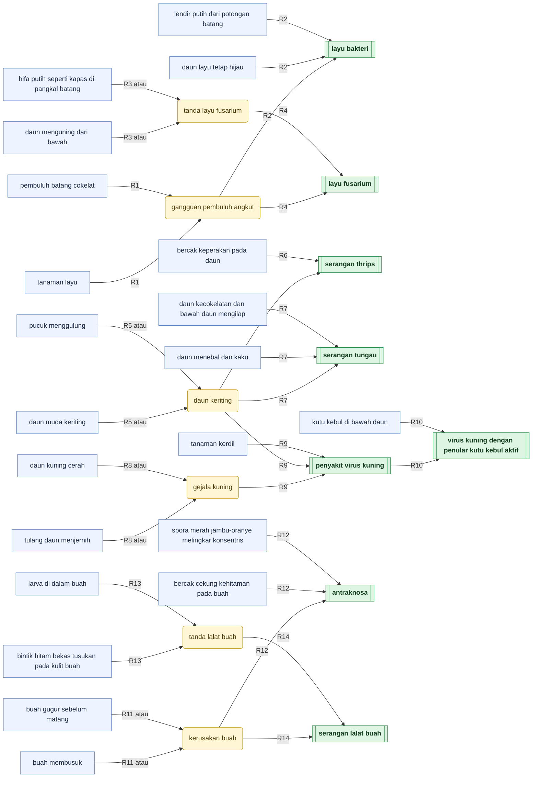
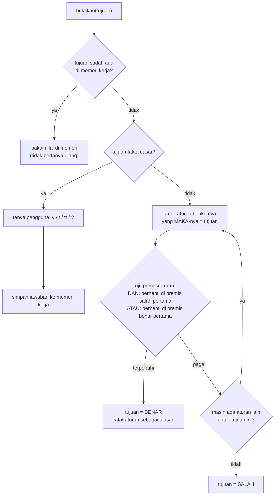
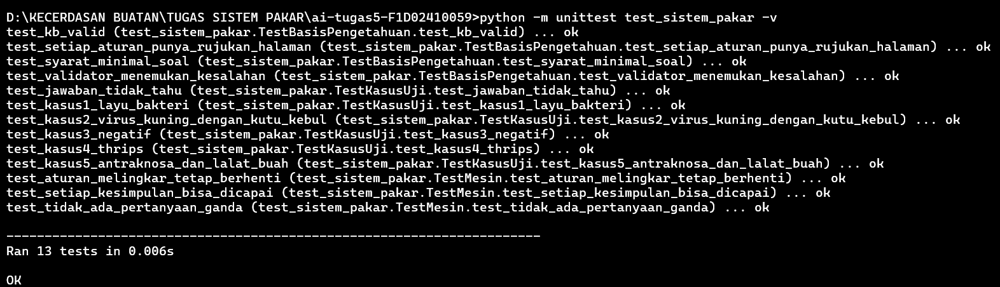
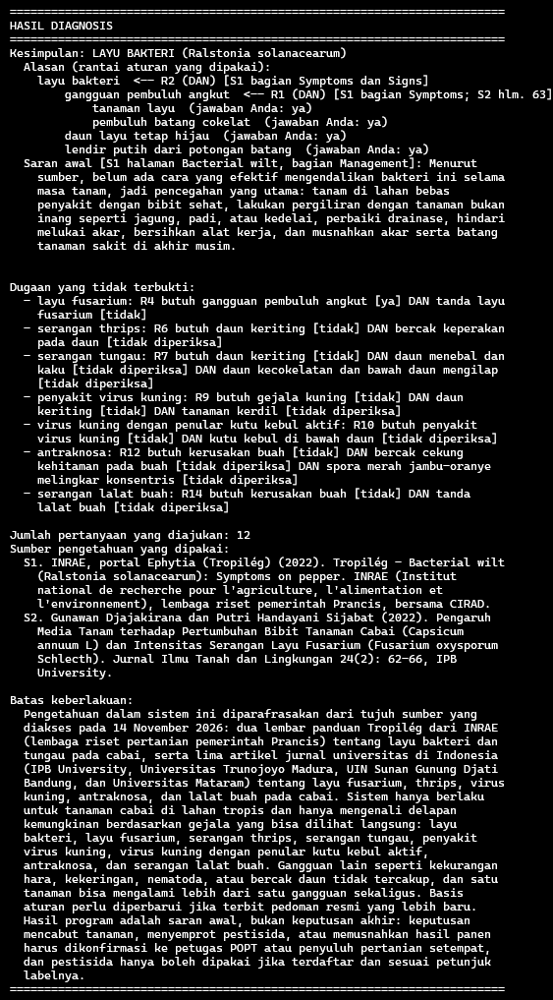
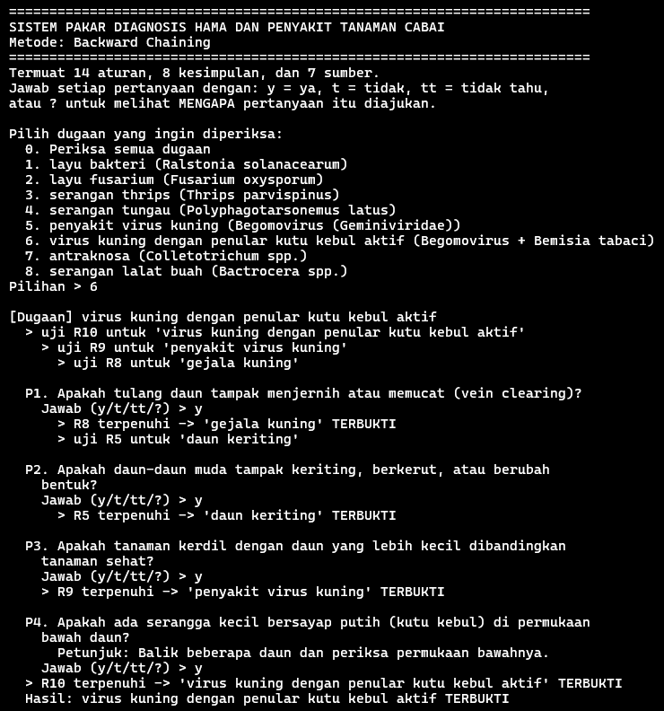

# TUGAS SISTEM PAKAR (EXPERT SYSTEM) KECERDASAN BUATAN

### Sistem Pakar Diagnosis Hama dan Penyakit Tanaman Cabai dengan Backward Chaining


Program konsultasi berbasis teks untuk mengenali penyebab gangguan pada tanaman cabai dari gejala yang terlihat. Pengetahuannya diambil dari tujuh sumber, yaitu lembar panduan lembaga riset pemerintah Prancis (INRAE) dan artikel jurnal universitas di Indonesia, lalu disusun menjadi 14 aturan IF-THEN di file JSON. Setiap aturan mencantumkan sumber beserta halaman atau bagian yang dirujuk. Mesin inferensinya adalah **Backward Chaining** yang ditulis sendiri: program memulai dari dugaan, lalu hanya menanyakan gejala yang benar-benar diperlukan untuk membuktikan dugaan itu.

---

## Daftar Isi

1. [Identitas](#1-identitas)
2. [Topik dan Cara Menjalankan Program](#2-topik-dan-cara-menjalankan-program)
3. [Sumber dan Tabel Aturan](#3-sumber-dan-tabel-aturan)
4. [Metode yang Dipilih dan Alasannya](#4-metode-yang-dipilih-dan-alasannya)
5. [Tiga Kasus Uji dan Screenshot](#5-tiga-kasus-uji-dan-screenshot)
6. [Batas Keberlakuan](#6-batas-keberlakuan)
7. [Penggunaan Alat Bantu AI](#7-penggunaan-alat-bantu-ai)

---

## 1. Identitas

| | |
|---|---|
| **Nama** | Jauda Avaro Zufaru |
| **NIM** | F1D02410059 |
| **Kelas** | C |
| **Mata kuliah** | Kecerdasan Buatan (MKL1303131) |
| **Program studi** | Teknik Informatika, Universitas Mataram |
| **Tugas** | Tugas 5: Membuat Sistem Pakar Sederhana |

---

## 2. Topik dan Cara Menjalankan Program

### 2.1 Topik

**Diagnosis hama dan penyakit tanaman cabai.** Beberapa gangguan pada cabai memiliki gejala yang mirip sehingga mudah tertukar. Layu bakteri dan layu fusarium sama-sama membuat tanaman layu dan pembuluh batangnya cokelat, tetapi pada layu bakteri daunnya tetap hijau dan potongan batangnya mengeluarkan lendir putih saat dicelupkan ke air, sedangkan pada layu fusarium daun menguning mulai dari bawah. Daun keriting juga bisa disebabkan thrips, tungau, atau virus kuning, dan yang membedakannya adalah gejala penyerta seperti bercak keperakan, daun yang menebal dan kaku, atau tulang daun yang menjernih. Membedakan kasus seperti ini adalah pekerjaan khas petugas POPT atau penyuluh pertanian, sehingga cocok dijadikan sistem pakar. Topik ini juga termasuk contoh topik yang diperbolehkan pada soal.

Sistem mengenali **8 kesimpulan**: layu bakteri, layu fusarium, serangan thrips, serangan tungau, penyakit virus kuning, virus kuning dengan penular kutu kebul aktif, antraknosa, dan serangan lalat buah. Setiap kesimpulan ditampilkan bersama alasannya (rantai aturan yang dipakai), sumber, dan saran pengendalian awal.

### 2.2 Kebutuhan

| Komponen | Keterangan |
|---|---|
| Bahasa | Python |
| Versi | Python 3.8 atau lebih baru (diuji pada Python 3.13) |
| Library | Tidak ada, hanya modul bawaan (`json`, `os`, `textwrap`, dan `unittest` untuk pengujian) |
| Sistem operasi | Windows, Linux, atau macOS |

### 2.3 Struktur Folder

```text
ai-tugas5-F1D02410059/
├── kb_cabai.json          # basis pengetahuan: sumber, aturan, pertanyaan, saran, batas
├── sistem_pakar.py        # mesin backward chaining + antarmuka konsultasi
├── test_sistem_pakar.py   # pengujian otomatis (unittest)
├── README.md
└── screenshot/            # bukti hasil uji
```

### 2.4 Menjalankan Program

Unduh atau clone repository ini, buka terminal di folder repository, lalu jalankan:

```bash
python sistem_pakar.py
```

Pada Windows, jika perintah `python` tidak dikenali, gunakan `py sistem_pakar.py`.

Program pertama-tama meminta pengguna memilih dugaan. Angka `0` memeriksa semua dugaan secara berurutan, sedangkan angka `1` sampai `8` memeriksa satu dugaan saja. Setelah itu program mengajukan pertanyaan satu per satu, dan setiap pertanyaan dijawab dengan salah satu pilihan berikut.

| Jawaban | Arti |
|---|---|
| `y` | ya, gejala itu ada |
| `t` | tidak ada |
| `tt` | tidak tahu (dianggap belum terbukti, dan program mengingatkan untuk memeriksanya lagi) |
| `?` | tampilkan **MENGAPA** pertanyaan itu diajukan |

Di akhir konsultasi, program menampilkan kesimpulan, alasan berupa rantai aturan, saran awal, penjelasan untuk dugaan yang tidak terbukti, jumlah pertanyaan, sumber yang dipakai, dan batas keberlakuan.

Pengujian otomatis dijalankan dengan:

```bash
python -m unittest -v
```

---

## 3. Sumber dan Tabel Aturan

### 3.1 Daftar Sumber

Ada tujuh sumber: dua lembar panduan dari lembaga riset pemerintah Prancis (INRAE) dan lima artikel jurnal yang diterbitkan universitas di Indonesia. Semua sumber berupa halaman web biasa (bukan unduhan sementara), dan setiap tautan sudah dicoba dibuka satu per satu pada 14 November 2026. Artikel jurnal juga dilengkapi DOI, sehingga tetap bisa ditemukan walaupun alamat situs jurnalnya berubah.

| Kode | Penulis (Tahun) | Judul | Penerbit | Tautan | Diakses |
|---|---|---|---|---|---|
| S1 | INRAE, Tropilég (2022) | Bacterial wilt (*Ralstonia solanacearum*): Symptoms on pepper | INRAE, lembaga riset pertanian pemerintah Prancis, bersama CIRAD | [Gejala pada cabai](https://ephytia.inrae.fr/en/C/23684/Tropileg-Symptoms-on-pepper) · [Pengendalian](https://ephytia.inrae.fr/en/C/23093/Tropileg-Bacterial-wilt-Ralstonia-solanacearum) | 14 November 2026 |
| S2 | Djajakirana, G. & Sijabat, P. H. (2022) | Pengaruh Media Tanam terhadap Pertumbuhan Bibit Tanaman Cabai (*Capsicum annuum* L) dan Intensitas Serangan Layu Fusarium (*Fusarium oxysporum* Schlecth) | *Jurnal Ilmu Tanah dan Lingkungan*, 24(2), 62–66, IPB University | [Halaman artikel](https://journal.ipb.ac.id/jtanah/article/view/42375) · [doi:10.29244/jitl.24.2.62-66](https://doi.org/10.29244/jitl.24.2.62-66) | 14 November 2026 |
| S3 | Yuliadhi, K. A. & Pratiwi, N. P. E. (2022) | Populasi *Thrips parvispinus* Karny (Thysanoptera: Thripidae) pada Bunga Tanaman Cabai Besar di Bali | *Agrovigor: Jurnal Agroekoteknologi*, 15(1), 6–9, Universitas Trunojoyo Madura | [Halaman artikel](https://journal.trunojoyo.ac.id/agrovigor/article/view/9237) · [doi:10.21107/agrovigor.v15i1.9237](https://doi.org/10.21107/agrovigor.v15i1.9237) | 14 November 2026 |
| S4 | INRAE, Tropilég (2022) | Acariosis deformans (tarsonema), *Polyphagotarsonemus latus* | INRAE, lembaga riset pertanian pemerintah Prancis, bersama CIRAD | [Halaman panduan](https://ephytia.inrae.fr/en/C/24347/Tropileg-Acariosis-deformans-tarsonema) | 14 November 2026 |
| S5 | Sulandari, S., Suseno, R., Hidayat, S. H., Harjosudarmo, J., & Sosromarsono, S. (2006) | Deteksi dan Kajian Kisaran Inang Virus Penyebab Penyakit Daun Keriting Kuning Cabai | *HAYATI Journal of Biosciences*, 13(1), 1–6, IPB University | [Halaman artikel](https://journal.ipb.ac.id/index.php/hayati/article/view/196) | 14 November 2026 |
| S6 | Prihatiningsih, N., Djatmiko, H. A., & Erminawati (2020) | Komponen Epidemi Penyakit Antraknosa pada Tanaman Cabai di Kecamatan Baturraden Kabupaten Banyumas | *Jurnal Agro*, 7(2), 203–212, UIN Sunan Gunung Djati Bandung | [Halaman artikel](https://journal.uinsgd.ac.id/index.php/ja/article/view/8000) · [doi:10.15575/8000](https://doi.org/10.15575/8000) | 14 November 2026 |
| S7 | Holis, A. I., Haryanto, H., & Isnaini, M. (2023) | Populasi dan Intensitas Serangan Lalat Buah (*Bactrocera* spp.) pada Pertanaman Cabai Keriting (*Capsicum annum* L.) di Desa Darmasari Kabupaten Lombok Timur | *Jurnal Ilmiah Mahasiswa Agrokomplek*, 2(1), 161–170, Universitas Mataram | [Halaman artikel](https://journal.unram.ac.id/index.php/jima/article/view/2332) · [doi:10.29303/jima.v2i1.2332](https://doi.org/10.29303/jima.v2i1.2332) | 14 November 2026 |

Setiap sumber dipakai untuk penyakit yang memang dibahasnya. **S1** menjelaskan gejala layu bakteri pada cabai: daun yang layu tetap hijau dan menempel di batang, pembuluh akar dan pangkal batang berwarna kuning hingga cokelat, serta uji gelas air, yaitu benang lendir putih yang keluar dari potongan batang dalam waktu sekitar lima menit. Halaman pengendaliannya menjadi dasar saran untuk layu bakteri. **S2** menjelaskan gejala layu fusarium pada cabai di hlm. 63: layu dimulai dari daun bawah, potongan pangkal batang memperlihatkan cincin cokelat pada berkas pembuluh, dan tempat infeksi tertutup hifa putih seperti kapas. **S3** menjelaskan gejala serangan *Thrips parvispinus* pada cabai, yaitu bercak keperakan yang berubah kecokelatan dan daun yang mengeriting (hlm. 6–7). **S4** menyebut cabai sebagai tanaman yang paling rentan terhadap tungau *Polyphagotarsonemus latus*, dengan gejala daun muda berubah bentuk, menggulung, menebal, kaku, dan berwarna perunggu kecokelatan dengan permukaan bawah yang mengilap. **S5** adalah penelitian IPB tentang penyakit daun keriting kuning cabai: tulang daun menjernih, daun menguning cerah, tepi daun menggulung ke atas, daun mengecil, tanaman kerdil, dan kutu kebul *Bemisia tabaci* sebagai penularnya (hlm. 1–3). **S6** menjelaskan gejala antraknosa pada buah cabai: bercak kehitaman yang bundar dan cekung, buah mengerut, membusuk, dan gugur, serta massa spora merah jambu hingga oranye yang membentuk cincin konsentris (hlm. 204–205). **S7** adalah penelitian Fakultas Pertanian Universitas Mataram di Lombok Timur yang menjelaskan gejala lalat buah pada cabai: bintik hitam bekas tusukan ovipositor pada kulit buah, larva yang memakan daging buah, lalu buah menjadi cokelat, lunak, membusuk, dan gugur sebelum waktunya (hlm. 166–167).

### 3.2 File Aturan

Seluruh pengetahuan disimpan di `kb_cabai.json`, terpisah dari kode program, sehingga aturan dapat diubah tanpa menyentuh kode.

| Kunci | Isi |
|---|---|
| `sumber` | Tujuh sumber lengkap (judul, penulis, penerbit, tahun, URL, DOI bila ada, tanggal akses) |
| `kesimpulan` | Delapan kesimpulan yang dapat dibuktikan, beserta nama ilmiahnya |
| `aturan` | 14 aturan IF-THEN; setiap aturan memiliki `id`, `jika`, `mode`, `maka`, `sumber`, dan `rujukan` (halaman atau bagian sumber) |
| `pertanyaan` | Teks pertanyaan untuk 21 fakta dasar |
| `petunjuk` | Cara memeriksa beberapa gejala, misalnya uji gelas air |
| `saran` | Saran pengendalian awal untuk tiap kesimpulan, juga dengan rujukannya |
| `batas` | Paragraf batas keberlakuan yang ditampilkan program |

Contoh satu aturan. `mode` bernilai `"dan"` (semua syarat harus terpenuhi) atau `"atau"` (cukup satu syarat):

```json
{
  "id": "R2",
  "jika": ["gangguan pembuluh angkut", "daun layu tetap hijau", "lendir putih dari potongan batang"],
  "mode": "dan",
  "maka": "layu bakteri",
  "sumber": ["S1"],
  "rujukan": "S1 bagian Symptoms dan Signs"
}
```

### 3.3 Tabel Aturan

Isi aturan adalah parafrasa dari sumber, bukan kutipan langsung. Untuk sumber INRAE yang berupa halaman web tanpa nomor halaman, rujukannya menunjuk nama bagian di halaman tersebut.

| Aturan | IF | THEN | Jenis hasil | Sumber |
|---|---|---|---|---|
| R1 | tanaman layu **DAN** pembuluh batang cokelat | gangguan pembuluh angkut | antara | S1 (Symptoms); S2 hlm. 63 |
| R2 | gangguan pembuluh angkut **DAN** daun layu tetap hijau **DAN** lendir putih dari potongan batang | **layu bakteri** | kesimpulan | S1 (Symptoms, Signs) |
| R3 | daun menguning dari bawah **ATAU** hifa putih seperti kapas di pangkal batang | tanda layu fusarium | antara | S2 hlm. 63 |
| R4 | gangguan pembuluh angkut **DAN** tanda layu fusarium | **layu fusarium** | kesimpulan | S2 hlm. 63 |
| R5 | daun muda keriting **ATAU** pucuk menggulung | daun keriting | antara | S3 hlm. 6–7; S4 (Symptoms); S5 hlm. 1, 3 |
| R6 | daun keriting **DAN** bercak keperakan pada daun | **serangan thrips** | kesimpulan | S3 hlm. 6–7 |
| R7 | daun keriting **DAN** daun menebal dan kaku **DAN** daun kecokelatan dan bawah daun mengilap | **serangan tungau** | kesimpulan | S4 (Symptoms) |
| R8 | tulang daun menjernih **ATAU** daun kuning cerah | gejala kuning | antara | S5 hlm. 1–2 |
| R9 | gejala kuning **DAN** daun keriting **DAN** tanaman kerdil | **penyakit virus kuning** | kesimpulan | S5 hlm. 1–3 |
| R10 | penyakit virus kuning **DAN** kutu kebul di bawah daun | **virus kuning dengan penular kutu kebul aktif** | kesimpulan | S5 hlm. 1–2 |
| R11 | buah membusuk **ATAU** buah gugur sebelum matang | kerusakan buah | antara | S6 hlm. 204; S7 hlm. 167 |
| R12 | kerusakan buah **DAN** bercak cekung kehitaman pada buah **DAN** spora merah jambu-oranye melingkar konsentris | **antraknosa** | kesimpulan | S6 hlm. 204–205 |
| R13 | bintik hitam bekas tusukan pada kulit buah **DAN** larva di dalam buah | tanda lalat buah | antara | S7 hlm. 166–167 |
| R14 | kerusakan buah **DAN** tanda lalat buah | **serangan lalat buah** | kesimpulan | S7 hlm. 161, 167 |

Ringkasan: 14 aturan, 8 kesimpulan, 6 fakta antara, 21 fakta dasar, dan 7 sumber.

### 3.4 Rantai Aturan

Delapan aturan memakai hasil aturan lain. R1 menghasilkan *gangguan pembuluh angkut* yang dipakai R2 dan R4, sedangkan R3 menghasilkan *tanda layu fusarium* untuk R4. R5 menghasilkan *daun keriting* yang dipakai bersama oleh R6, R7, dan R9. R8 menghasilkan *gejala kuning* untuk R9. Rantai terpanjang ada pada R10, yang memakai kesimpulan *penyakit virus kuning* dari R9, yang pada gilirannya memakai hasil R5 dan R8 (kesimpulan di atas kesimpulan). Pada bagian buah, R11 dan R13 menghasilkan *kerusakan buah* dan *tanda lalat buah* yang dipakai R12 dan R14. R13 sengaja memakai DAN, karena bintik hitam kecil juga bisa muncul di awal antraknosa (S6 hlm. 204), sehingga lalat buah baru disimpulkan jika larva juga ditemukan di dalam buah.

Diagram berikut menunjukkan jaringan inferensinya (biru = fakta dasar yang ditanyakan, kuning = fakta antara, hijau = kesimpulan):



---

## 4. Metode yang Dipilih dan Alasannya

### 4.1 Metode: Backward Chaining (BC)

Backward chaining bersifat *goal-driven*. Penalaran dimulai dari sebuah dugaan, lalu mesin mencari aturan yang bagian MAKA-nya sama dengan dugaan itu dan menjadikan setiap syarat aturan tersebut sebagai sub-tujuan baru. Sebuah fakta baru ditanyakan ke pengguna hanya jika fakta itu tidak dapat dihasilkan oleh aturan mana pun (fakta dasar).

### 4.2 Alasan Memilih Backward Chaining

Alasan pertama, cara kerjanya sama dengan cara pakar mendiagnosis. Materi kuliah menyebut backward chaining cocok untuk diagnosis, dan memang petugas lapangan biasanya sudah punya dugaan, misalnya "apakah ini layu bakteri?", lalu memeriksa gejala yang mendukung dugaan tersebut.

Alasan kedua, pertanyaan yang diajukan jauh lebih sedikit. Beberapa pemeriksaan butuh usaha, misalnya membelah batang atau melakukan uji gelas air, sehingga sebaiknya diminta hanya jika memang perlu. Begitu satu syarat **DAN** bernilai salah, syarat lain pada aturan itu tidak ditanyakan. Begitu satu syarat **ATAU** bernilai benar, syarat sisanya juga tidak ditanyakan. Fakta yang sudah dijawab disimpan di memori kerja sehingga tidak ditanyakan dua kali. Hasil pengukuran pada program ini:

| Skenario | Pertanyaan pada BC | Pertanyaan jika semua fakta ditanyakan di awal |
|---|---|---|
| Kasus uji 1 (memeriksa semua dugaan) | 12 | 21 |
| Kasus uji 2 (satu dugaan) | 4 | 21 |
| Kasus uji 3 (kasus negatif) | 9 | 21 |
| Semua gejala dijawab "tidak" | 7 | 21 |

Alasan ketiga, penjelasan MENGAPA muncul dengan sendirinya. Saat bertanya, BC selalu tahu aturan mana yang sedang diuji, sehingga program dapat menjawab ketika pengguna mengetik `?`. Ini sesuai dengan komponen fasilitas penjelasan pada struktur sistem pakar di materi kuliah.

### 4.3 Langkah Kerja Mesin

Inti mesin ada pada dua fungsi di `sistem_pakar.py`, yaitu `buktikan(kb, tujuan)` dan `uji_premis(kb, aturan)`, yang saling memanggil secara rekursif.

```text
fungsi buktikan(tujuan):
    1. jika tujuan sudah ada di memori kerja: kembalikan nilainya (tidak bertanya ulang)
    2. jika tujuan fakta dasar:
           tanya pengguna (y / t / tt / ?), simpan jawabannya ke memori, kembalikan
    3. jika tujuan sedang dibuktikan: kembalikan salah (pengaman aturan melingkar)
    4. untuk setiap aturan r yang r.maka = tujuan:
           jika uji_premis(r) benar:
               catat r sebagai alasan tujuan, simpan benar, kembalikan benar
    5. simpan salah ke memori, kembalikan salah

fungsi uji_premis(r):
    mode "dan"  : periksa premis satu per satu, berhenti di premis salah pertama
    mode "atau" : periksa premis satu per satu, berhenti di premis benar pertama
    (setiap premis diperiksa dengan memanggil buktikan(premis))
```



Pada pilihan "periksa semua dugaan", langkah di atas dijalankan untuk kedelapan kesimpulan secara berurutan dengan memori kerja yang sama. Kesimpulan yang terbukti di tengah penalaran ikut ditampilkan, misalnya *penyakit virus kuning* yang terbukti saat program menguji R10.

### 4.4 Fitur Pendukung

| Fitur | Penjelasan |
|---|---|
| Fasilitas **MENGAPA** (`?`) | Menampilkan aturan yang sedang diuji beserta rujukan sumbernya ketika sebuah pertanyaan diajukan |
| Fasilitas **BAGAIMANA** (alasan) | Menampilkan rantai aturan dari kesimpulan sampai jawaban pengguna, lengkap dengan ID aturan, mode, dan rujukan sumber |
| Jawaban "tidak tahu" (`tt`) | Fakta dianggap belum terbukti, dan di akhir program mengingatkan gejala mana yang perlu diperiksa lagi |
| Penjelasan dugaan yang gagal | Setiap dugaan yang tidak terbukti ditampilkan bersama status tiap syaratnya: ya, tidak, tidak tahu, atau tidak diperiksa |
| Jejak penalaran | Setiap langkah BC (aturan yang diuji dan hasilnya) dicetak agar proses inferensi dapat diikuti. Dapat dimatikan dengan mengubah `TAMPILKAN_JEJAK = False` |
| Pengaman aturan melingkar | Tujuan yang sedang dibuktikan dicatat, sehingga aturan seperti A → B dan B → A tidak membuat program berputar terus |
| Validasi basis pengetahuan | Sebelum konsultasi, program memeriksa mode aturan, sumber yang tidak terdaftar, fakta tanpa pertanyaan, kesimpulan tanpa aturan atau saran, keberadaan rantai aturan, dan syarat minimal soal |
| Pengujian otomatis | 13 unit test, termasuk lima kasus uji, jawaban "tidak tahu", tidak adanya pertanyaan ganda, aturan melingkar, dan validator |

Hasil pengujian otomatis (`python -m unittest -v`):



---

## 5. Tiga Kasus Uji dan Screenshot

Ringkasan kasus uji. Jawaban yang tidak disebut dijawab `t` (tidak).

| # | Pilihan menu | Jawaban "ya" | Kesimpulan yang diharapkan | Jumlah pertanyaan |
|---|---|---|---|---|
| 1 | `0` (semua dugaan) | tanaman layu, pembuluh batang cokelat, daun layu tetap hijau, lendir putih dari potongan batang | layu bakteri | 12 |
| 2 | `6` (satu dugaan) | tulang daun menjernih, daun muda keriting, tanaman kerdil, kutu kebul di bawah daun | penyakit virus kuning; virus kuning dengan penular kutu kebul aktif | 4 |
| 3 | `0` (semua dugaan) | tanaman layu, daun muda keriting (pembuluh batang dijawab `tt`) | **tidak ada** (kasus negatif) | 9 |

Dua kasus tambahan diuji secara otomatis di `test_sistem_pakar.py`: gejala daun muda keriting dan bercak keperakan menghasilkan *serangan thrips*, sedangkan gejala buah membusuk, bercak cekung kehitaman, spora melingkar konsentris, bintik hitam bekas tusukan, dan larva di dalam buah menghasilkan *antraknosa* sekaligus *serangan lalat buah*.

### Kasus 1: Layu Bakteri (rantai R1 → R2, dengan fasilitas MENGAPA)

Urutan jawaban: pilih `0`, P1 `y`, P2 `y`, P3 `?` lalu `y`, P4 `y`, kemudian P5 sampai P12 `t`.

Pada P3, pengguna mengetik `?` dan program menjelaskan bahwa pertanyaan itu diajukan untuk menguji R2. Setelah R1 membuktikan *gangguan pembuluh angkut*, R2 membuktikan **layu bakteri**. Saat memeriksa layu fusarium, fakta *gangguan pembuluh angkut* diambil dari memori kerja, sehingga P1 dan P2 tidak ditanyakan ulang.




### Kasus 2: Virus Kuning dengan Penular Kutu Kebul (rantai R8, R5 → R9 → R10)

Urutan jawaban: pilih `6`, lalu P1 sampai P4 `y`.

Pengguna hanya memeriksa satu dugaan. BC bekerja mundur dari R10 ke R9, lalu ke R8 dan R5. Karena R8 dan R5 bermode ATAU, cukup satu syarat yang dijawab "ya", sehingga hanya **4 dari 21** fakta yang ditanyakan. Kesimpulan *penyakit virus kuning* yang terbukti di tengah penalaran ikut ditampilkan.




### Kasus 3: Kasus Negatif (gejala ada, tetapi bukti tidak cukup)

Urutan jawaban: pilih `0`, P1 `y`, P2 `tt`, P3 `y`, kemudian P4 sampai P9 `t`.

Tanaman layu, tetapi pengguna tidak tahu apakah pembuluh batangnya cokelat, sehingga R1 tidak terpenuhi dan kedua dugaan layu ikut gugur. Daun muda keriting membuat *daun keriting* terbukti, tetapi ciri pembeda thrips (bercak keperakan), tungau (daun menebal dan kaku), dan virus kuning (gejala kuning) tidak ditemukan. Program menyatakan **tidak ada kesimpulan**, menjelaskan status syarat tiap dugaan, dan mengingatkan bahwa *pembuluh batang cokelat* perlu diperiksa lagi.


---

## 6. Batas Keberlakuan

Pengetahuan dalam sistem ini diparafrasakan dari tujuh sumber yang diakses pada 14 November 2026: dua lembar panduan Tropilég dari INRAE (lembaga riset pertanian pemerintah Prancis) tentang layu bakteri dan tungau pada cabai, serta lima artikel jurnal universitas di Indonesia (IPB University, Universitas Trunojoyo Madura, UIN Sunan Gunung Djati Bandung, dan Universitas Mataram) tentang layu fusarium, thrips, virus kuning, antraknosa, dan lalat buah pada cabai. Sistem hanya berlaku untuk tanaman cabai di lahan tropis dan hanya mengenali delapan kemungkinan berdasarkan gejala yang bisa dilihat langsung: layu bakteri, layu fusarium, serangan thrips, serangan tungau, penyakit virus kuning, virus kuning dengan penular kutu kebul aktif, antraknosa, dan serangan lalat buah. Gangguan lain seperti kekurangan hara, kekeringan, nematoda, atau bercak daun tidak tercakup, dan satu tanaman bisa mengalami lebih dari satu gangguan sekaligus. Basis aturan perlu diperbarui jika terbit pedoman resmi yang lebih baru. Hasil program adalah saran awal, bukan keputusan akhir: keputusan mencabut tanaman, menyemprot pestisida, atau memusnahkan hasil panen harus dikonfirmasi ke petugas POPT atau penyuluh pertanian setempat, dan pestisida hanya boleh dipakai jika terdaftar dan sesuai petunjuk labelnya.

Paragraf yang sama disimpan di kunci `batas` pada `kb_cabai.json` dan ditampilkan program di akhir setiap konsultasi.

---

## 7. Penggunaan Alat Bantu AI

Saya menggunakan AI (Claude) sebagai alat bantu belajar, yaitu untuk membantu mencari dan memeriksa sumber, menyusun kerangka kode, dan merapikan README. Pada revisi ini, sumber versi sebelumnya diganti karena sebagian tautannya tidak dapat dibuka. Sumber pengganti dipilih yang berupa halaman web biasa, dan setiap tautan sudah saya coba buka sendiri. Isi setiap aturan sudah saya cocokkan dengan halaman atau bagian sumber yang dirujuk, kode dan pengujiannya sudah saya jalankan sendiri, dan saya memahami serta dapat menjelaskan seluruh kode dan aturan yang digunakan.
